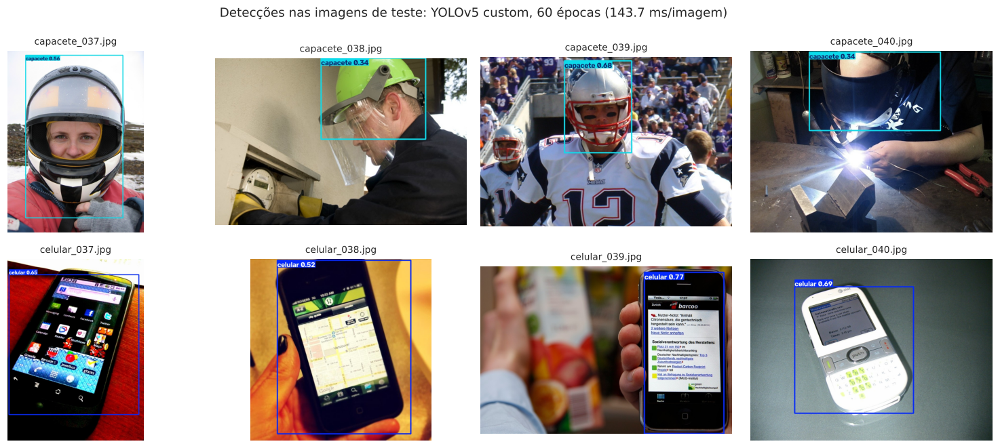

# Grupo 64 · FIAP · Fase 6 · O despertar da Rede Neural

Sistema de visão computacional para a FarmTech Solutions: detecção de **capacete** (EPI obrigatório) e **celular** (item restrito) em fotos reais, com uma **YOLOv5 customizada** (30 e 60 épocas), comparada a uma **YOLO padrão** pré-treinada no COCO e a uma **CNN treinada do zero**.

**Aluno:** Willian Kauê Tobias do Carmo · **RM:** 570038 · Tecnologia em Inteligência Artificial, FIAP

## Entregáveis

| Item | Onde |
|---|---|
| Notebook com as Entregas 1 e 2 (código executado, saídas e análises) | [`WillianKaueTobiasDoCarmo_rm570038_pbl_fase6.ipynb`](./WillianKaueTobiasDoCarmo_rm570038_pbl_fase6.ipynb) · [](https://colab.research.google.com/github/willktdc/grupo64-fiap-fase6/blob/main/WillianKaueTobiasDoCarmo_rm570038_pbl_fase6.ipynb) |
| Vídeo demonstrativo (até 5 min, não listado) | [YouTube](https://youtu.be/nH-3fWDhFdQ) |
| Dataset (80 imagens, splits, rótulos, créditos) | [`dataset/`](./dataset) |
| Figuras geradas (curvas, matrizes de confusão, prints das detecções) | [`results/`](./results) |

## Resultado em uma linha

> A **YOLOv5 customizada com 60 épocas** atingiu mAP@0.5 de **0,995** no conjunto de teste e reconheceu **8/8** imagens sem falsos positivos (com 30 épocas: mAP@0.5 de 0,892 e 6/8, falhando nos capacetes atípicos). A **YOLO padrão** (COCO, sem treino) acertou apenas os celulares (**4/8**), por não conhecer a classe capacete; a **CNN treinada do zero** classificou **6/8**, errando por contexto de cena. Execução registrada em CPU: 15 e 30 min de treino; ~140 ms por imagem na inferência.



## O que está no notebook

O notebook é o relatório completo, com o passo a passo e os resultados comentados. Em resumo:

1. **Dataset**: 80 fotos reais (40 por classe) curadas do Open Images V7, divididas em 32 / 4 / 4 por classe, com manifesto reproduzível e créditos por imagem;
2. **Rotulação** no Make Sense para todas as imagens, conferida contra o gabarito oficial do Open Images (IoU);
3. **Treinamento** YOLOv5s com 30 e 60 épocas, mesma semente, e comparação de precisão, erro e tempo;
4. **Validação, teste e inferência**, com prints das imagens de teste processadas;
5. **Entrega 2**: YOLO padrão (COCO, sem treino) e CNN do zero, avaliadas com a customizada em facilidade de uso, precisão, tempo de treino e tempo de inferência.

## Como executar

- Abra o notebook no Colab (badge acima), selecione **Runtime → T4 GPU** e execute todas as células. Sem Google Drive, o notebook clona este repositório e usa `dataset/` (imagens e rótulos) automaticamente; os dois treinos levam poucos minutos.
- Com Google Drive (fluxo usado no desenvolvimento): coloque `dataset_fase6.zip` em `MyDrive/fiap_fase6/` e os zips exportados do Make Sense em `MyDrive/fiap_fase6/makesense/`.

## Estrutura do repositório

```
├── README.md
├── WillianKaueTobiasDoCarmo_rm570038_pbl_fase6.ipynb
├── dataset/
│   ├── images/{train,val,test}/          64 / 8 / 8 imagens (celular_*.jpg, capacete_*.jpg)
│   ├── labels/{train,val,test}/          rótulos exportados do Make Sense (formato YOLO)
│   ├── gabarito_openimages/{...}/        caixas oficiais do Open Images, usadas só para conferência
│   ├── manifesto.csv                     arquivo, classe, split, ID de origem, caixa oficial, autor, licença
│   └── CREDITOS.md                       atribuição imagem a imagem
└── results/                              figuras e tabelas geradas pelo notebook (curvas, matrizes, prints das detecções)
```

## Créditos e licenças

- Imagens: subconjunto do [Open Images V7](https://storage.googleapis.com/openimages/web/index.html) (Google); fotos do Flickr sob licença CC BY 2.0, com atribuição individual em `dataset/CREDITOS.md`.
- Código: [YOLOv5](https://github.com/ultralytics/yolov5) (Ultralytics, AGPL-3.0), TensorFlow/Keras, [Make Sense](https://www.makesense.ai).
